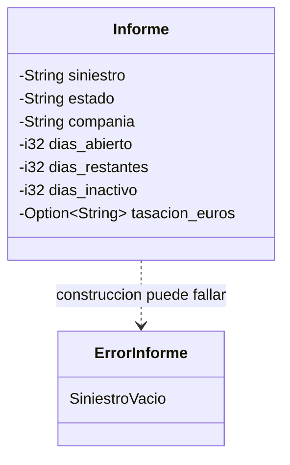

# Modelo de dominio de HU001

## Alcance

Este modelo cubre el milestone M0: los datos de las peritaciones que permiten
analizar su clasificación en HU001. No implementa la clasificación ni calcula
penalizaciones; eso pertenece a M1. Los importes mensuales de HU002 y el acceso
desde dispositivos de HU003 quedan fuera.

## Glosario

| Término | Significado en el problema |
| --- | --- |
| Informe | Expediente pericial representado por una fila del CSV diario. |
| Siniestro | Número del expediente; identifica el informe a través de las actualizaciones. |
| Estado | Estado operativo del expediente, leído de la columna `Estado`. |
| Compañía | Aseguradora de la peritación, leída de `Compañía`. |
| Tasación | Cuantía aproximada de los daños; puede no venir informada. |
| Urgencia | Característica que HU001 pide poder ordenar y consultar. |
| Warning | Penalización acumulada: uno, dos o tres warnings tienen consecuencias descritas en la jornada. |

## Caso real anotado

La jornada describe que cada día se carga una tabla con una fila por expediente
activo del mes. El mismo siniestro puede aparecer en la siguiente actualización,
con cambios en estado y contadores de días. Por ello, `Informe` conserva el
número de siniestro como identidad; los datos de la fila describen su estado
actual. La columna `Tasación` puede faltar, así que se representa como opcional.
No se documenta aquí ningún dato personal de una fila concreta del CSV.

## Eventos y datos por historia

| Historia | Hechos del dominio que aparecen en las fuentes |
| --- | --- |
| HU001 | Se importa el CSV diario; el usuario consulta informes pendientes y su urgencia; contacta o programa una peritación; marca la acción. Los criterios de la jornada usan compañía, tasación, estado de nuevo, antigüedad, inactividad y warnings. |
| HU002 | Se importa la tabla mensual de minutas y se calculan importes netos. Fuera de M0. |
| HU003 | Se consulta el sistema desde oficina o móvil. Fuera de M0. |

## Conceptos y ficheros

| Concepto | Fichero | Historia |
| --- | --- | --- |
| Informe (entidad) | `src/modelos/informe.rs` | HU001 |
| Error al crear un informe sin número de siniestro | `src/modelos/informe.rs` | HU001 |

## Entidad u objeto valor

`Informe` se modela como entidad: la jornada describe el mismo expediente en
actualizaciones diarias y el usuario puede marcar en él acciones de contacto o
peritación. El número de siniestro de la tabla es la identidad disponible en las
fuentes. No se añade un identificador artificial.

`Tasación` no tiene tipo numérico propio todavía. La jornada dice que puede
faltar, pero no precisa formato, separador decimal ni unidad fraccionaria del
CSV; se conserva como texto opcional para no inventar reglas de conversión en
M0. Compañía y estado también se conservan como texto porque las fuentes no
enumeran todos sus valores permitidos.

## Relaciones

## Decisiones y alternativas

- Se eligió `Informe` como entidad con identidad natural (`Siniestro`), en vez de
  tratar cada fila como un valor independiente, porque las acciones del usuario
  y las actualizaciones diarias se refieren al mismo expediente. Confirmar con
  el responsable del producto que el número de siniestro es único y estable.
- Se usa `i32` para los contadores de días hasta confirmar si el CSV contiene
  valores negativos para expedientes vencidos; `u32` descartaría esa posibilidad.
- La tasación se conserva como texto opcional hasta conocer el formato real del
  CSV. Una representación monetaria tipada puede incorporarse cuando se
  acuerde la conversión.
- No se añaden tipos cerrados para estado o compañía porque la jornada no lista
  todos sus valores. Tampoco se incorpora `Warnings`: aunque se describe el
  concepto, la tabla de 16 columnas no indica una columna para ese contador y
  las reglas para calcularlo pertenecen a M1.
- Se excluyen los datos personales y operativos que no participan en los
  criterios descritos para HU001 (asegurado, perito, gestor, dirección, lugar,
  características, reserva y notas). Se añadirán si una regla o flujo de HU001
  los requiere.
